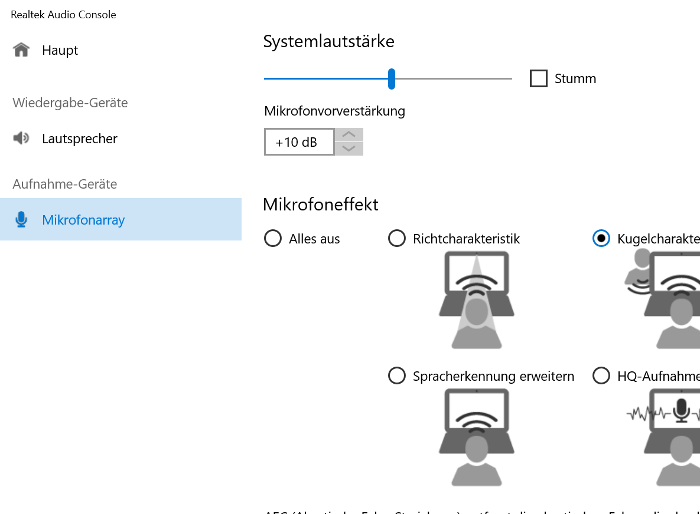

# Realtek Audio Console RPC Fix

[](https://www.paypal.com/donate/?hosted_button_id=CFANQH892RPH2)


One-click repair for the **Realtek Audio Console** error:

> **Can not connect to RPC service.**

The console opens, shows a spinner or an empty window, and never connects to the
Realtek audio service. This project diagnoses the whole RPC chain and restores it
without reinstalling the audio driver.



## What it does

- Detects why the console cannot reach its RPC service.
- Re-enables the vendor logon task **`RtkAudUService64_BG`** (the usual culprit).
- Creates a safe fallback logon task if the vendor task is missing entirely.
- Starts the per-user helper **`RtkAudUService64.exe -background`** immediately, so
  no sign-out or reboot is required.
- Makes sure `RtkAudioUniversalService`, Windows Audio and the audio endpoints are up.
- Optionally resets the console app package and reopens it.
- Verifies the result and prints a clear `OK / PROBLEM` report.
- Is idempotent and reversible (`-Action Restore`).

## The problem

Realtek Audio Console is a UWP application. It does not talk to the audio driver
directly. It talks to a small per-user COM/RPC helper:

```
RtkAudUService64.exe -background
```

That helper is started at logon by a scheduled task created by the Realtek driver:

```
Task Scheduler -> RtkAudUService64_BG
```

If that task is **disabled** (by a cleanup tool, a "debloat" script, a Windows
update, or a failed install), the helper never starts. The console then launches
but cannot connect:

```
Can not connect to RPC service.
```

The audio itself usually keeps working, because `RtkAudioUniversalService` and
Windows Audio are separate. Only the control panel is broken.

## Download

Get the latest release from:

**https://github.com/DigiSphereX/realtek-audio-console-rpc-fix/releases/latest**

Download the ZIP, extract it, and run `src\Run-Fix.cmd`.

## Usage

### One-click (recommended)

1. Download and extract the release ZIP.
2. Double-click **`src\Run-Fix.cmd`**.
3. Accept the Windows **Administrator** prompt.
4. Wait for `Repair complete`. The console opens automatically.

### PowerShell

```powershell
# Read-only report - no changes, no admin required
.\src\Fix-RealtekAudioConsole.ps1 -Action Diagnose

# Repair (self-elevates)
.\src\Fix-RealtekAudioConsole.ps1 -Action Fix

# Repair, reset the app state, then open the console
.\src\Fix-RealtekAudioConsole.ps1 -Action Fix -ResetApp -LaunchApp

# Undo: disable the task and stop the helper
.\src\Fix-RealtekAudioConsole.ps1 -Action Restore
```

### Sample diagnostic output

```
OS              : Microsoft Windows 11 Pro (build 26200)
Realtek driver  : Realtek High Definition Audio  v6.0.8821.1

Check                              Status   Detail
-----                              ------   ------
RtkAudioUniversalService           OK       Running / Auto
RtkAudUService64_BG (logon task)   PROBLEM  State=Disabled Enabled=False
RPC helper in user session         PROBLEM  not running
Windows Audio services             OK       Audiosrv=Running, AudioEndpointBuilder=Running
Realtek Audio Console package      OK       v1.1.137.0 / Ok
Realtek audio endpoints            OK       Lautsprecher (Realtek(R) Audio)=OK

Result: 2 problem(s) found. Run with -Action Fix to repair.
```

## How it works

1. **Pre-flight** - confirms Windows 10/11, the Realtek service and the audio stack.
2. **Service** - sets `RtkAudioUniversalService` to `Automatic` and starts it.
3. **Logon task** - enables `RtkAudUService64_BG` and relaxes the battery/time-limit
   settings. If the task does not exist, it registers a fallback task
   `RealtekAudioConsoleRpcHelper` that runs `RtkAudUService64.exe -background` at logon.
4. **Helper now** - runs the task on demand (or starts the helper directly) in the
   current user session.
5. **App (optional)** - `-ResetApp` clears the UWP local state and `-LaunchApp` opens it.
6. **Verify** - checks service state, task state and a live helper process in a
   user session (session ID != 0).

Nothing outside the Realtek/Windows Audio chain is changed.

## Troubleshooting

| Symptom | What to try |
|---|---|
| `Task 'RtkAudUService64_BG' was not found` | The script creates the fallback task automatically. Reboot once if the console still fails. |
| `Service 'RtkAudioUniversalService' is not installed` | Reinstall the Realtek audio driver from your PC/laptop vendor, then run the script again. |
| The window was already open | Close Realtek Audio Console completely and open it again. |
| Still stuck after a repair | Run with `-ResetApp`, or run `-Action Diagnose` and check which line says `PROBLEM`. |
| Console missing from the Start menu | Reinstall **Realtek Audio Console** from the Microsoft Store. |
| Helper keeps stopping | Check that the task is not disabled by a third-party "optimizer" after every reboot. |

Useful manual checks:

```powershell
Get-ScheduledTask -TaskName RtkAudUService64_BG |
    Select-Object TaskName, State, @{n='Enabled';e={$_.Settings.Enabled}}

Get-Process RtkAudUService64 | Select-Object Id, SessionId

Get-Service RtkAudioUniversalService, Audiosrv, AudioEndpointBuilder
```

## Build from source

Nothing to compile. The project is a plain PowerShell 5.1 script:

1. Clone the repository.
2. Edit `src/Fix-RealtekAudioConsole.ps1` if needed.
3. Test on a real Windows machine with `src/Run-Diagnose.cmd` (read-only) and
   `src/Run-Fix.cmd` (repair).

## Requirements

- Windows 10 or Windows 11 (x64).
- Realtek audio hardware with the Realtek Audio Universal Service installed.
- PowerShell 5.1 (built into Windows).
- Administrator rights for `-Action Fix` / `-Action Restore` (diagnose is read-only).

No driver download, no installation, no reboot.

## Disclaimer / Backup advice

Use at your own risk. The script only enables a scheduled task and starts a signed
Realtek helper, but every machine is different:

- Create a restore point before running system-level tools.
- Read the source - it is a single, commented PowerShell file.
- `-Action Restore` disables the task and stops the helper, but leaves the Realtek
  service running because Windows Audio still needs it.

The author is not responsible for any unintentional damage or data loss.

## License

MIT - see [LICENSE](LICENSE).

Copyright (c) 2026 M. Basheer (DigiSphereX)

## ☕ Support this project

Free and open source (MIT). If this project saved you time or money, consider a small thank-you:

- **GitHub Sponsors** -> https://github.com/sponsors/DigiSphereX
- **PayPal** -> https://www.paypal.com/donate/?hosted_button_id=CFANQH892RPH2
